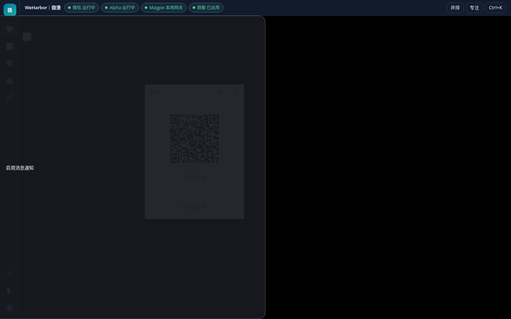
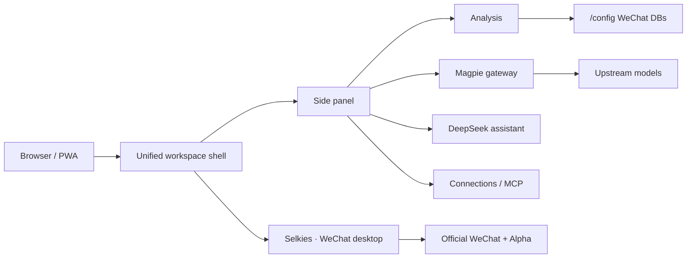

# WeHarbor｜微港

[](https://github.com/fliaping/weharbor/stargazers)
[](https://github.com/fliaping/weharbor/pkgs/container/weharbor)
[](LICENSE)
[](https://github.com/fliaping/weharbor)

**把官方 Linux 微信、数据分析、Magpie 网关和 AI 助手放进同一个浏览器工作区。**
One browser workspace for official Linux WeChat, chat analytics, Magpie gateway, and an AI assistant.

[English](docs/README.en.md) · [首次使用](docs/first-run.md) · [API](docs/api.md) · [运维](docs/operations.md) · [PWA](docs/pwa.md) · [工作区](docs/workspace.md)

<p align="center">
  
</p>

## 为什么是 WeHarbor / Why

| | 中文 | English |
| --- | --- | --- |
| 真实微信 | 官方 deb，不是第三方协议客户端 | Official WeChat deb, not a third-party protocol client |
| 一体工作区 | 左侧导航 + 微信主画面 + 可并排助手/分析/Magpie | Left rail, WeChat main pane, split side apps |
| 数据自持 | 单容器、单 `/config` 卷，可私有部署 | Single container, one `/config` volume, self-hosted |
| 本地脱敏 | Magpie 网关默认脱敏后再给模型 | Magpie gateway redacts before model calls |

## 功能一览 / Features

- **统一工作区**：微信 Selkies 画面为主窗格；助手、分析、Magpie、连接可并排或专注全屏。
- **设计系统**：浅色/深色、中文优先字体栈、状态芯片、命令面板（Ctrl/⌘+K）、Alt+1–5 快捷键（微信 / 分析 / 助手 / Magpie / 连接）。
- **官方微信 + Alpha**：窗口切换、浏览器通知、HTTP API / MCP / SSE。
- **分析与助手**：WeFlow 密钥复用、数据库/WAL/图片解密；DeepSeek Harness 经 Magpie 本地网关。
- **PWA**：可安装为独立窗口；手机底部标签栏适配。

## 三步启动 / Quick start

需要 Linux amd64、Docker Engine 与 Compose v2：

```bash
git clone https://github.com/fliaping/weharbor.git && cd weharbor
./scripts/init.sh && ./scripts/build.sh
docker compose up -d
```

打开 `https://localhost:3001`，使用 `.env` 中的 `CUSTOM_USER` / `PASSWORD` 登录。
首次 HTTPS 为自签名证书。默认只绑定本机；跨机器请用 Tailscale Serve 或 HTTPS 反向代理（需 WebSocket）。

预构建镜像：`ghcr.io/fliaping/weharbor:edge`（main）或功能标签如 `magpie-gateway`。

## 安全与隐私 / Security

- 登录密码与 API Token 保存在本机 `.env` / `/config`，**不要**提交到 Git。
- Magpie 默认对密钥与个人敏感字段做**本地可逆脱敏**后再请求模型。
- 不建议将 3001 直接暴露公网；优先 Tailscale 或自有反向代理。
- Alpha 为闭源未签名发行版，许可证未声明；详见 [组件许可](THIRD_PARTY_NOTICES.md)。

## 架构 / Architecture



## 当前状态

源码版本 0.1.0，仓库 [fliaping/weharbor](https://github.com/fliaping/weharbor)。
组合：WeChat 4.1.13.23、Alpha 0.2.0、Selkies 2.0.0（`ghcr.io/linuxserver/baseimage-selkies:debiantrixie`，按 digest 锁定）。仅 `linux/amd64`。

> Alpha 密钥助手内置 2026-11-15 有效期，需随上游更新。


## 本地构建与启动

需要 Linux amd64 主机、Docker Engine、Compose v2 / Buildx 和 Python 3.10+：

~~~bash
git clone https://github.com/fliaping/weharbor.git
cd weharbor
./scripts/init.sh
./scripts/build.sh
docker compose up -d
~~~

build.sh 会下载并校验 versions.lock.json 中锁定的组件。离线构建可提前把
Alpha-0.2.0-x64.deb 放到 downloads/alpha.deb，把
WeChatLinux_4.1.13.23_amd64.deb 放到 downloads/wechat.deb。

打开 https://localhost:3001，使用 .env 中的 CUSTOM_USER 和 PASSWORD 登录。
首次 HTTPS 使用自签名证书。init.sh 会生成随机网页登录密码，并自动设置
宿主用户 UID/GID；已有 .env 不会被覆盖。不要把 .env 提交到 Git。

默认只绑定本机地址。需要从其他机器访问时，在 .env 设置
BIND_ADDRESS=0.0.0.0，或使用 Tailscale Serve / 支持 WebSocket 的 HTTPS 反向代理
转发 3001 端口。不建议直接暴露到公网。

## 首次设置

按 [完整教程](docs/first-run.md) 操作：

1. 扫码登录微信，等待本地账号与聊天数据库生成。
2. 在 Alpha 首次设置向导中勾选“我已了解”，点击“连接微信”，选择账号与数据目录
   （/config/Documents/xwechat_files，兼容链接指向 /config/xwechat_files）。
3. 按向导获取数据库密钥（可选获取图片密钥），完成设置后确认能看到聊天记录。
4. 在 Alpha 设置中启用 HTTP API（端口 5031），复制访问 Token；
   需要实时通知时同时开启主动推送。

当前锁定的 Alpha 0.2.0 在 Linux 上自动获取数据库密钥可能报
`NATIVE_WECHAT_CAPTURE_PLATFORM_UNAVAILABLE`，上游 Issue #5 已确认并计划修复。
这不是容器缺少 SYS_PTRACE；可在 Alpha 中手动导入该账号已有的数据库密钥，
或等待经验证的上游修复版本。容器健康检查通过不代表密钥获取已成功。

Alpha 的 API 只监听容器内 127.0.0.1:5031；容器内 nginx 在 5032 端口转发，
Compose 默认映射到宿主机 127.0.0.1:${API_PORT:-5031}。所有请求（/health 除外）
仍需 Alpha 的 Bearer Token；带浏览器 Origin 头的请求会被拒绝。

浏览器消息通知需要把 Alpha Token 保存到 /config/.config/weharbor/alpha-api-token
（权限 600），或设置 ALPHA_API_TOKEN 环境变量，因为 Alpha 把 Token 加密保存在
密钥环中，通知桥无法直接读取。

## 接入 AI 工具

仓库提供 alpha-api skill，附带无需 pip 依赖的 Python 调用脚本：

~~~bash
npx --yes skills add https://github.com/fliaping/weharbor --skill alpha-api --yes
~~~

在 AI 执行环境配置 ALPHA_API_BASE 与 ALPHA_API_TOKEN（或 ALPHA_API_TOKEN_FILE）。
路由来自 Alpha 0.2.0 的静态分析，参数与返回字段仍待在真实实例上核对。详见 [安装页](docs/install-skill.md)。

## 配置

| 配置 | 默认值 | 用途 |
| --- | --- | --- |
| WEHARBOR_IMAGE | weharbor:0.1.0 | 镜像地址与版本 |
| DATA_DIR | ./data | 持久化数据目录 |
| CUSTOM_USER / PASSWORD | 自动生成 | 浏览器桌面登录（nginx Basic Auth） |
| BIND_ADDRESS | 127.0.0.1 | 桌面端口绑定地址 |
| HTTP_PORT / HTTPS_PORT | 3000 / 3001 | 桌面入口 |
| API_BIND_ADDRESS / API_PORT | 127.0.0.1 / 5031 | 宿主机上的 Alpha API 地址（映射到容器 5032） |
| AUTO_START_WECHAT | true | 自动启动微信 |
| AUTO_START_ALPHA | false | 自动启动 Alpha（可选；网页工作区不再显示 Alpha） |
| PUID / PGID | init.sh 检测 | 持久化文件所属用户 |
| ENABLE_APP_SWITCHER | true | 应用切换入口 |
| APP_SWITCHER_MODE | web | 网页贴边应用条；desktop 恢复旧桌面切换器 |
| ENABLE_WINDOW_DEFAULTS | true | 初始窗口布局 |
| ENABLE_BROWSER_NOTIFICATIONS | true | 浏览器通知 |
| ENABLE_MAGPIE | true | 启动 Magpie 网页管理端与本地脱敏模型网关 |

GPU 加速可选：宿主机存在 /dev/dri 时运行
docker compose -f compose.yaml -f compose.gpu.yaml up -d。
SYS_PTRACE 供 Alpha 读取微信进程内存以获取数据库密钥。

与 wechat-selkies 时期相比，微信自动点击登录与夜间定时重启已移除；
容器内暂未预装中文输入法。

## 开发与贡献

~~~bash
python3 scripts/check.py
./scripts/build.sh
./scripts/smoke-test.sh weharbor:0.1.0
~~~

版本、安装包 SHA256 与基础镜像 digest 集中在 versions.lock.json。
root/ 只保存本项目的集成层（启动脚本、窗口布局、通知桥、API 代理、旧配置迁移）。

## 许可与致谢

WeHarbor 的集成代码使用 MIT 许可证。微信、Alpha、Selkies 及其他组件保留
各自许可；Alpha 的分发条款未明确，公开发布组合镜像前需先核实。
详见 THIRD_PARTY_NOTICES.md。

感谢 LinuxServer.io、Selkies 与 wechat-selkies 项目的维护者，
以及 Alpha 的作者。WeHarbor 是独立的社区集成项目。
