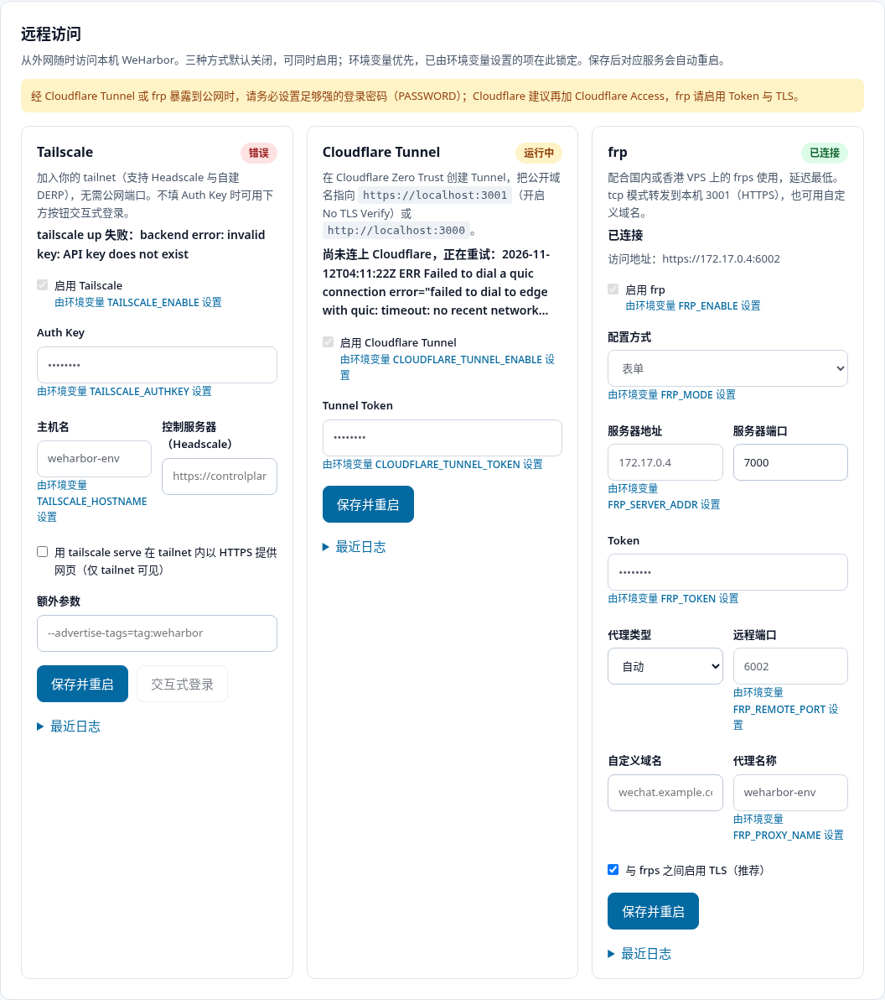

# 远程访问：Tailscale / Cloudflare Tunnel / frp

WeHarbor 内置三种可选的内网穿透方式，让你在外网随时打开微信桌面。三者**默认全部关闭**，
互不依赖、可以同时启用，每种都作为独立的 s6 服务（`svc-tailscale`、`svc-cloudflared`、
`svc-frpc`）以 `abc` 用户运行：未配置时只是空闲等待，不会反复重启容器；进程异常退出后
按 5 秒起、最长 5 分钟的退避自动重试；日志中的 Token / Auth Key 会被替换为 `[REDACTED]`。

| 方式 | 适合 | 国内延迟 | 是否暴露公网 |
| --- | --- | --- | --- |
| frp + 国内/香港 VPS | 中国大陆随时访问，延迟最低 | 低（取决于 VPS） | 是 |
| Tailscale（可配 Headscale / 自建 DERP） | 只给自己的设备用，最安全 | 自建 DERP 后低 | 否，仅 tailnet |
| Cloudflare Tunnel | 无需 VPS、有域名托管在 Cloudflare | 较高 | 是 |



## 两种配置入口

1. **网页**：打开工作区「连接」（Alt+5）→「远程访问」，填写后点「保存并重启」。
   设置保存在 `/config/.config/weharbor/remote-access.json`（权限 0600，仅 abc 可读）；
   密钥在页面上只显示为 `••••••••`，接口从不返回明文；保持掩码不变即沿用原值。
   页面每 5 秒刷新运行状态、tailnet IP / 访问地址和最近日志（已脱敏）。
2. **环境变量**（`.env` / compose）：**环境变量优先**。已由环境变量设置的项在网页上锁定，
   并标注「由环境变量 … 设置」。

保存设置后，对应服务会检测到配置变化并自行退出，由 s6 立即按新配置重启；其它两种方式不受影响。
修改环境变量需要重建容器（`docker compose up -d`）。

## 环境变量

| 变量 | 含义 |
| --- | --- |
| `TAILSCALE_ENABLE` | `true` 启用 Tailscale（设置了 `TAILSCALE_AUTHKEY` 时自动启用）；`false` 强制关闭 |
| `TAILSCALE_AUTHKEY` | Auth Key（`tskey-auth-…`）；留空则在网页上交互式登录 |
| `TAILSCALE_HOSTNAME` | tailnet 中的设备名，默认 `weharbor` |
| `TAILSCALE_LOGIN_SERVER` | 自建控制服务器（Headscale）地址 |
| `TAILSCALE_SERVE` | `true` 时执行 `tailscale serve`，在 tailnet 内以 `https://<主机名>.<tailnet>.ts.net` 提供网页 |
| `TAILSCALE_EXTRA_ARGS` | 追加给 `tailscale up` 的参数，如 `--advertise-tags=tag:weharbor` |
| `CLOUDFLARE_TUNNEL_ENABLE` | `true`/`false`；设置了 Token 时自动启用 |
| `CLOUDFLARE_TUNNEL_TOKEN` | Cloudflare Zero Trust 中 Tunnel 的连接 Token |
| `FRP_ENABLE` | `true`/`false`；设置了 `FRP_SERVER_ADDR` 时自动启用 |
| `FRP_MODE` | `simple`（用下面的变量生成配置，默认）或 `raw`（使用 `/config/frp/frpc.toml`） |
| `FRP_SERVER_ADDR` / `FRP_SERVER_PORT` | frps 地址与端口（默认 7000） |
| `FRP_TOKEN` | frps 的 `auth.token` |
| `FRP_PROXY_TYPE` | `tcp`（默认，有远程端口时）/`https`（按域名 SNI 透传到 3001）/`http`（按域名到 3000） |
| `FRP_REMOTE_PORT` | tcp 模式下 frps 上开放的端口，访问 `https://<VPS>:<端口>` |
| `FRP_CUSTOM_DOMAIN` | http/https 模式的域名（frps 需配置 `vhostHTTPSPort` / `vhostHTTPPort`） |
| `FRP_PROXY_NAME` | 代理名称，默认 `weharbor`；多台 WeHarbor 共用一个 frps 时需各不相同 |
| `FRP_TLS` | 与 frps 之间的 TLS，默认开启 |

## Tailscale

运行在**用户态网络**模式（`--tun=userspace-networking`），不需要 `NET_ADMIN` 或 `/dev/net/tun`；
状态保存在 `/config/.local/share/weharbor/workspace/tailscale.state`，重建容器无需重新登录。

- 有 Auth Key：填 `TAILSCALE_AUTHKEY` 即可。
- 没有 Auth Key：在「连接」页启用后点「交互式登录」，页面会显示登录链接。
- 想在 tailnet 内直接用浏览器打开：开启 `TAILSCALE_SERVE=true`（需在 Tailscale 后台启用 HTTPS 证书）。
  用户态模式下，其它设备无法直接访问容器的 `100.x:3001`，请用 serve。
- 国内延迟高：在国内 VPS 上自建 [DERP](https://tailscale.com/kb/1118/custom-derp-servers) 并在 ACL 中配置；
  或用 Headscale（`TAILSCALE_LOGIN_SERVER`）。
- 永远不要对 WeHarbor 使用 `tailscale funnel`。

## Cloudflare Tunnel

1. Cloudflare Zero Trust →「Networks → Tunnels」创建 Tunnel，复制 Token。
2. 为 Tunnel 添加 Public Hostname，服务填 `https://localhost:3001` 并在 TLS 中开启 **No TLS Verify**
   （或填 `http://localhost:3000`）。
3. 填入 `CLOUDFLARE_TUNNEL_TOKEN` 或在网页中保存。状态变为「已连接」表示已向 Cloudflare 注册连接。
4. **强烈建议**为该域名配置 Cloudflare Access（邮箱验证码或 SSO），在 WeHarbor 登录前再加一层认证。

## frp

在 VPS 上运行 frps（示例 `frps.toml`）：

```toml
bindPort = 7000
auth.method = "token"
auth.token = "换成很长的随机字符串"
transport.tls.force = true
# 使用域名模式时：vhostHTTPSPort = 443
```

WeHarbor 侧最简配置（tcp 模式，访问 `https://<VPS>:6001`，证书为自签名）：

```bash
FRP_SERVER_ADDR=frp.example.com
FRP_TOKEN=与 frps 相同
FRP_REMOTE_PORT=6001
```

需要完整控制（多代理、`stcp`、`proxyProtocol` 等）时，把配置放在 `/config/frp/frpc.toml`
（即宿主机 `data/frp/frpc.toml`），并设置 `FRP_MODE=raw` 或在网页选择「自定义 frpc.toml」；
未做任何网页/环境配置时，存在该文件即自动以 raw 模式启用。启动前会先执行 `frpc verify`。
本机网页端口：HTTPS `127.0.0.1:3001`，HTTP `127.0.0.1:3000`。

大陆 VPS 使用 80/443 绑定域名需要 ICP 备案；未备案可用 tcp 模式的非标准端口，或改用香港 VPS。

## 安全须知

- 通过 Cloudflare Tunnel 或 frp 暴露到公网后，任何人都能看到登录页：**必须**设置足够强的
  `PASSWORD`（`scripts/init.sh` 默认生成随机密码），不要关闭网页登录。
- Cloudflare：加 Cloudflare Access。frp：务必设置 Token、保持 TLS 开启，并在 VPS 防火墙只开放需要的端口。
- `/workspace/mcp` 与 `/workspace/data/*` 不走网页登录，而是要求 workspace Bearer Token；请妥善保管
  `/config/.config/weharbor/workspace.token`。
- 优先选择不暴露公网的 Tailscale；需要公网时优先选择带 Access 的 Cloudflare 或自己的 frps。
- 远程访问设置文件含密钥，备份 `/config` 时请注意保管。
